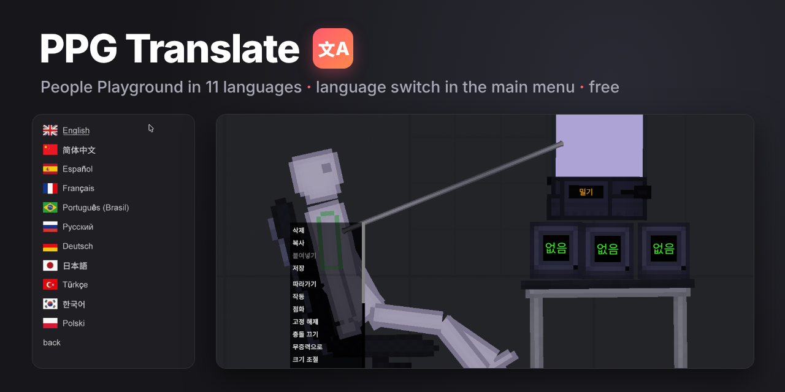

<p align="center"></p>

# People Playground Translation: PPG Translate

People Playground in 11 languages. Pick yours:

🇬🇧 [English](#english) · 🇨🇳 [简体中文](#zh-hans) · 🇪🇸 [Español](#es) · 🇫🇷 [Français](#fr) · 🇧🇷 [Português (Brasil)](#pt-br) · 🇷🇺 [Русский](#ru) · 🇩🇪 [Deutsch](#de) · 🇯🇵 [日本語](#ja) · 🇹🇷 [Türkçe](#tr) · 🇰🇷 [한국어](#ko) · 🇵🇱 [Polski](#pl)

**[⬇ Download / Скачать / 下载 / Descargar / Télécharger / Baixar / Herunterladen / ダウンロード / İndir / 다운로드 / Pobierz](../../releases/latest)**

---

<a name="english"></a>
## 🇬🇧 English

**People Playground translation mod.** Play People Playground in Russian, Chinese, Spanish, French, Portuguese, German, Japanese, Turkish, Korean or Polish.

- A language button in the main menu. The text changes on the spot, no restart.
- Menus, settings, item names and descriptions, map names and labels on items are translated.
- Works with the game's safe mode: it is a BepInEx plugin, so you don't need Mod Enabler.
- Japanese, Korean and Chinese fonts are included.
- No internet access, no changes to game files or saves.

**Install:** download the x64 archive from [Releases](../../releases/latest), copy everything into the game folder next to `People Playground.exe` and start the game. Full guide with Mac and Steam Deck steps: [INSTALL_en.txt](INSTALL/INSTALL_en.txt).

**Support the author:**
- [lava.top](https://app.lava.top/teohanki) (Visa, Mastercard, Apple Pay, PayPal, SEPA, PIX, iDEAL, Bancontact, MB WAY, Mir, SBP)
- [Boosty](https://boosty.to/teohanki/donate) (Visa, Mastercard, Mir, SBP)

The mod is free and always will be. With each update I add supporters' names to the [Supporters](#supporters) list.

Found a bug, a bad translation or have an idea? Write in [Issues](../../issues).

New versions are published in [Releases](../../releases). To get an email about each one: **Watch → Custom → Releases** (a GitHub account is needed). In the game, the GitHub button in the support menu opens this page.

<sub>Keywords: People Playground translation, People Playground mod, People Playground language mod, change language People Playground, PPG translation, People Playground localization, BepInEx plugin</sub>

---

<a name="zh-hans"></a>
## 🇨🇳 简体中文

**People Playground 汉化补丁（简体中文）。** 让《人类游乐场》People Playground 显示中文。

- 主菜单里有语言按钮，切换后立即生效，无需重启。
- 汉化了菜单、设置、物品名称和说明、地图名称以及物品上的文字。
- 这是 BepInEx 插件，游戏的安全模式不影响它，不需要 Mod Enabler。
- 自带中文字体，不会出现方块乱码。
- 不联网，不修改游戏文件和存档。

**安装：** 在 [Releases](../../releases/latest) 下载 x64 压缩包，把全部内容复制到游戏目录（`People Playground.exe` 所在文件夹），然后启动游戏，在菜单中选择「简体中文」。详细说明见 [INSTALL_zh-Hans.txt](INSTALL/INSTALL_zh-Hans.txt)。

**支持作者：**
- [lava.top](https://app.lava.top/teohanki)（Visa、Mastercard、Apple Pay、PayPal、SEPA、PIX、iDEAL、Bancontact、MB WAY、Mir、SBP）
- [Boosty](https://boosty.to/teohanki/donate)（Visa、Mastercard、Mir、SBP）

这个模组免费，并且永远免费。每次更新时，我都会把支持者的名字加入[致谢名单](#supporters)。

发现错误、翻译问题或有好点子？请在 [Issues](../../issues) 里告诉我。

新版本会发布在 [Releases](../../releases)。想收到邮件通知：**Watch → Custom → Releases**（需要 GitHub 账号）。游戏内“支持作者”菜单里的 GitHub 按钮会打开本页。

<sub>关键词：People Playground 汉化, 人类游乐场 汉化, 人类游乐场 中文, People Playground 中文补丁, 人类游乐场 中文版, 人民游乐场 汉化, People Playground 怎么调中文, 人类游乐场 模组</sub>

---

<a name="es"></a>
## 🇪🇸 Español

**Traducción de People Playground al español.** Juega a People Playground en español.

- Botón de idioma en el menú principal. El texto cambia al momento, sin reiniciar.
- Traduce menús, ajustes, nombres y descripciones de objetos, nombres de mapas y textos sobre los objetos.
- Funciona con el modo seguro del juego: es un plugin de BepInEx y no necesita Mod Enabler.
- No se conecta a internet ni toca los archivos del juego ni tus partidas.

**Instalación:** descarga el archivo x64 de [Releases](../../releases/latest), copia todo su contenido a la carpeta del juego, junto a `People Playground.exe`, y abre el juego. Guía completa: [INSTALL_es.txt](INSTALL/INSTALL_es.txt).

**Apoya al autor:**
- [lava.top](https://app.lava.top/teohanki) (Visa, Mastercard, Apple Pay, PayPal, SEPA, PIX, iDEAL, Bancontact, MB WAY, Mir, SBP)
- [Boosty](https://boosty.to/teohanki/donate) (Visa, Mastercard, Mir, SBP)

El mod es gratis y siempre lo será. En cada actualización añado los nombres de quienes me apoyan a la lista de [agradecimientos](#supporters).

¿Encontraste un error, una mala traducción o tienes una idea? Escríbeme en [Issues](../../issues).

Las versiones nuevas se publican en [Releases](../../releases). Para recibir un correo con cada una: **Watch → Custom → Releases** (hace falta una cuenta de GitHub). En el juego, el botón GitHub del menú «apoyar al autor» abre esta página.

<sub>Palabras clave: People Playground en español, traducción People Playground, People Playground español mod, parche español People Playground, cómo poner People Playground en español, mod de idioma People Playground</sub>

---

<a name="fr"></a>
## 🇫🇷 Français

**Traduction française de People Playground.** Jouez à People Playground en français.

- Un bouton de langue dans le menu principal. Le texte change tout de suite, sans redémarrer.
- Menus, paramètres, noms et descriptions des objets, noms des cartes et textes sur les objets : tout est traduit.
- Compatible avec le mode sans échec du jeu : c'est un plugin BepInEx, Mod Enabler est inutile.
- Pas d'accès à internet, aucune modification des fichiers du jeu ni des sauvegardes.

**Installation :** téléchargez l'archive x64 dans [Releases](../../releases/latest), copiez tout son contenu dans le dossier du jeu, à côté de `People Playground.exe`, puis lancez le jeu. Guide complet : [INSTALL_fr.txt](INSTALL/INSTALL_fr.txt).

**Soutenir l'auteur :**
- [lava.top](https://app.lava.top/teohanki) (Visa, Mastercard, Apple Pay, PayPal, SEPA, PIX, iDEAL, Bancontact, MB WAY, Mir, SBP)
- [Boosty](https://boosty.to/teohanki/donate) (Visa, Mastercard, Mir, SBP)

Le mod est gratuit et le restera toujours. À chaque mise à jour, j'ajoute le nom des donateurs à la liste des [remerciements](#supporters).

Un bug, une mauvaise traduction ou une idée ? Écrivez-moi dans les [Issues](../../issues).

Les nouvelles versions sortent dans [Releases](../../releases). Pour recevoir un e-mail à chaque fois : **Watch → Custom → Releases** (compte GitHub requis). Dans le jeu, le bouton GitHub du menu « soutenir l'auteur » ouvre cette page.

<sub>Mots-clés : People Playground en français, traduction française People Playground, patch FR People Playground, mettre People Playground en français, mod de langue People Playground</sub>

---

<a name="pt-br"></a>
## 🇧🇷 Português (Brasil)

**Tradução de People Playground para português (PT-BR).** Jogue People Playground em português.

- Botão de idioma no menu principal. O texto muda na hora, sem reiniciar.
- Traduz menus, configurações, nomes e descrições dos itens, nomes dos mapas e textos nos itens.
- Funciona com o modo seguro do jogo: é um plugin do BepInEx e não precisa de Mod Enabler.
- Não acessa a internet nem mexe nos arquivos do jogo ou nos seus saves.

**Instalação:** baixe o arquivo x64 em [Releases](../../releases/latest), copie tudo para a pasta do jogo, ao lado de `People Playground.exe`, e abra o jogo. Guia completo: [INSTALL_pt-BR.txt](INSTALL/INSTALL_pt-BR.txt).

**Apoie o autor:**
- [lava.top](https://app.lava.top/teohanki) (Visa, Mastercard, Apple Pay, PayPal, SEPA, PIX, iDEAL, Bancontact, MB WAY, Mir, SBP)
- [Boosty](https://boosty.to/teohanki/donate) (Visa, Mastercard, Mir, SBP)

O mod é gratuito e sempre vai ser. A cada atualização, coloco o nome de quem apoia na lista de [agradecimentos](#supporters).

Achou um bug, uma tradução errada ou tem uma ideia? Escreva em [Issues](../../issues).

As versões novas saem em [Releases](../../releases). Para receber um e-mail a cada uma: **Watch → Custom → Releases** (precisa de conta no GitHub). No jogo, o botão GitHub do menu «apoiar o autor» abre esta página.

<sub>Palavras-chave: People Playground em português, tradução People Playground PT-BR, People Playground traduzido, como colocar People Playground em português, mod de tradução People Playground</sub>

---

<a name="ru"></a>
## 🇷🇺 Русский

**Русификатор People Playground.** Перевод игры People Playground на русский язык.

- Кнопка выбора языка в главном меню. Текст меняется сразу, перезапуск не нужен.
- Переведены меню, настройки, названия и описания предметов, названия карт и надписи на предметах.
- Работает в безопасном режиме игры: это плагин BepInEx, Mod Enabler не нужен.
- Плагин не ходит в интернет и не трогает файлы игры и сохранения.

**Установка:** скачайте архив x64 в [Releases](../../releases/latest), скопируйте всё его содержимое в папку игры рядом с `People Playground.exe` и запустите игру. Подробно, с Mac и Steam Deck: [INSTALL_ru.txt](INSTALL/INSTALL_ru.txt).

**Поддержать автора:**
- [Boosty](https://boosty.to/teohanki/donate) (Visa, Mastercard, МИР, СБП)
- [lava.top](https://app.lava.top/teohanki) (Visa, Mastercard, Apple Pay, PayPal, SEPA, PIX, iDEAL, Bancontact, MB WAY, МИР, СБП)

Мод бесплатный и таким останется. С каждым обновлением я вписываю имена поддержавших в [список благодарностей](#supporters).

Нашли баг, кривой перевод или есть идея? Пишите в [Issues](../../issues).

Новые версии выходят в [Releases](../../releases). Чтобы получать письмо о каждой: **Watch → Custom → Releases** (нужен аккаунт GitHub). В игре сюда ведёт кнопка GitHub в меню «поддержать автора».

<sub>Ключевые слова: русификатор People Playground, People Playground на русском, перевод People Playground, русификатор PPG, как сделать People Playground на русском, People Playground русский язык, руссификатор People Playground 1.28</sub>

---

<a name="de"></a>
## 🇩🇪 Deutsch

**People Playground auf Deutsch.** Deutsche Übersetzung für People Playground.

- Sprachknopf im Hauptmenü. Der Text wechselt sofort, ohne Neustart.
- Übersetzt Menüs, Einstellungen, Namen und Beschreibungen der Gegenstände, Kartennamen und Beschriftungen auf Gegenständen.
- Läuft im abgesicherten Modus des Spiels: Es ist ein BepInEx-Plugin, Mod Enabler brauchst du nicht.
- Kein Internetzugriff, keine Änderungen an Spieldateien oder Spielständen.

**Installation:** Lade das x64-Archiv unter [Releases](../../releases/latest) herunter, kopiere den ganzen Inhalt in den Spielordner neben `People Playground.exe` und starte das Spiel. Ausführliche Anleitung: [INSTALL_de.txt](INSTALL/INSTALL_de.txt).

**Den Autor unterstützen:**
- [lava.top](https://app.lava.top/teohanki) (Visa, Mastercard, Apple Pay, PayPal, SEPA, PIX, iDEAL, Bancontact, MB WAY, Mir, SBP)
- [Boosty](https://boosty.to/teohanki/donate) (Visa, Mastercard, Mir, SBP)

Der Mod ist kostenlos und bleibt es auch. Mit jedem Update trage ich die Namen der Unterstützer in die [Danksagungen](#supporters) ein.

Fehler, schlechte Übersetzung oder eine Idee? Schreib mir in den [Issues](../../issues).

Neue Versionen erscheinen unter [Releases](../../releases). Für eine E-Mail bei jeder: **Watch → Custom → Releases** (GitHub-Konto nötig). Im Spiel öffnet der GitHub-Button im Menü «Autor unterstützen» diese Seite.

<sub>Stichwörter: People Playground Deutsch, People Playground deutsche Übersetzung, People Playground auf Deutsch stellen, Deutsch Patch People Playground, Sprachmod People Playground</sub>

---

<a name="ja"></a>
## 🇯🇵 日本語

**People Playground 日本語化 MOD。** People Playground を日本語で遊べます。

- メインメニューに言語ボタンがあります。切り替えはすぐに反映され、再起動は不要です。
- メニュー、設定、アイテム名と説明、マップ名、アイテム上の文字を翻訳しています。
- BepInEx プラグインなので、ゲームのセーフモードでも動きます。Mod Enabler は不要です。
- 日本語フォントを同梱しているので、文字化けしません。
- インターネットに接続せず、ゲームファイルやセーブデータを変更しません。

**導入方法：** [Releases](../../releases/latest) から x64 版をダウンロードし、中身をすべて `People Playground.exe` があるフォルダーにコピーしてゲームを起動します。詳しくは [INSTALL_ja.txt](INSTALL/INSTALL_ja.txt) を参照してください。

**作者を支援する：**
- [lava.top](https://app.lava.top/teohanki)（Visa、Mastercard、Apple Pay、PayPal、SEPA、PIX、iDEAL、Bancontact、MB WAY、Mir、SBP）
- [Boosty](https://boosty.to/teohanki/donate)（Visa、Mastercard、Mir、SBP）

この MOD は無料で、これからもずっと無料です。更新のたびに、支援者のお名前を[クレジット](#supporters)に載せます。

バグや誤訳、アイデアは [Issues](../../issues) で教えてください。

新バージョンは [Releases](../../releases) で公開します。公開のたびにメールを受け取るには **Watch → Custom → Releases**（GitHub アカウントが必要）。ゲーム内の「作者を支援する」メニューにある GitHub ボタンからもこのページを開けます。

<sub>キーワード：People Playground 日本語化, People Playground 日本語, ピープルプレイグラウンド 日本語化, People Playground 日本語化 MOD, People Playground 翻訳</sub>

---

<a name="tr"></a>
## 🇹🇷 Türkçe

**People Playground Türkçe yama.** People Playground'u Türkçe oyna.

- Ana menüde dil düğmesi var. Metin hemen değişir, yeniden başlatmaya gerek yok.
- Menüler, ayarlar, eşya adları ve açıklamaları, harita adları ve eşyaların üzerindeki yazılar çevrildi.
- Oyunun güvenli modunda çalışır: bir BepInEx eklentisidir, Mod Enabler gerekmez.
- İnternete bağlanmaz, oyun dosyalarına ve kayıtlarına dokunmaz.

**Kurulum:** [Releases](../../releases/latest) sayfasından x64 arşivini indir, içindeki her şeyi `People Playground.exe` dosyasının bulunduğu oyun klasörüne kopyala ve oyunu başlat. Ayrıntılı rehber: [INSTALL_tr.txt](INSTALL/INSTALL_tr.txt).

**Yapımcıyı destekle:**
- [lava.top](https://app.lava.top/teohanki) (Visa, Mastercard, Apple Pay, PayPal, SEPA, PIX, iDEAL, Bancontact, MB WAY, Mir, SBP)
- [Boosty](https://boosty.to/teohanki/donate) (Visa, Mastercard, Mir, SBP)

Mod ücretsiz ve hep ücretsiz kalacak. Her güncellemede destekçilerin adını [teşekkürler](#supporters) listesine ekliyorum.

Hata, kötü çeviri ya da bir fikrin mi var? [Issues](../../issues) sayfasına yaz.

Yeni sürümler [Releases](../../releases) sayfasında yayımlanır. Her sürümde e-posta almak için: **Watch → Custom → Releases** (GitHub hesabı gerekir). Oyunda "yapımcıyı destekle" menüsündeki GitHub düğmesi bu sayfayı açar.

<sub>Anahtar kelimeler: People Playground Türkçe yama, People Playground Türkçe, People Playground Türkçe yapma, People Playground çeviri, People Playground dil modu</sub>

---

<a name="ko"></a>
## 🇰🇷 한국어

**People Playground 한글 패치.** People Playground를 한국어로 즐기세요.

- 메인 메뉴에 언어 버튼이 있습니다. 바로 바뀌며 다시 시작할 필요가 없습니다.
- 메뉴, 설정, 아이템 이름과 설명, 맵 이름, 아이템에 적힌 글자를 번역했습니다.
- BepInEx 플러그인이라 게임의 안전 모드에서도 작동합니다. Mod Enabler는 필요 없습니다.
- 한글 글꼴이 들어 있어 글자가 깨지지 않습니다.
- 인터넷에 접속하지 않고 게임 파일과 세이브를 건드리지 않습니다.

**설치:** [Releases](../../releases/latest)에서 x64 압축 파일을 내려받아 모든 내용을 `People Playground.exe`가 있는 게임 폴더에 복사한 뒤 게임을 실행하세요. 자세한 안내: [INSTALL_ko.txt](INSTALL/INSTALL_ko.txt).

**제작자 후원하기:**
- [lava.top](https://app.lava.top/teohanki) (Visa, Mastercard, Apple Pay, PayPal, SEPA, PIX, iDEAL, Bancontact, MB WAY, Mir, SBP)
- [Boosty](https://boosty.to/teohanki/donate) (Visa, Mastercard, Mir, SBP)

이 모드는 무료이고 앞으로도 계속 무료입니다. 업데이트할 때마다 후원자 이름을 [크레딧](#supporters)에 올립니다.

버그, 잘못된 번역, 아이디어가 있으면 [Issues](../../issues)에 남겨 주세요.

새 버전은 [Releases](../../releases)에 올라옵니다. 새 버전마다 메일을 받으려면 **Watch → Custom → Releases** (GitHub 계정 필요). 게임 안 "제작자 후원하기" 메뉴의 GitHub 버튼으로도 이 페이지가 열립니다.

<sub>키워드: People Playground 한글패치, 피플 플레이그라운드 한글패치, People Playground 한국어, 피플 플레이그라운드 한글, People Playground 한글 모드</sub>

---

<a name="pl"></a>
## 🇵🇱 Polski

**Spolszczenie People Playground.** Graj w People Playground po polsku.

- Przycisk języka w menu głównym. Tekst zmienia się od razu, bez restartu.
- Przetłumaczone są menu, ustawienia, nazwy i opisy przedmiotów, nazwy map i napisy na przedmiotach.
- Działa w trybie awaryjnym gry: to wtyczka BepInEx, Mod Enabler nie jest potrzebny.
- Nie łączy się z internetem i nie zmienia plików gry ani zapisów.

**Instalacja:** pobierz archiwum x64 z [Releases](../../releases/latest), skopiuj całą zawartość do folderu gry obok `People Playground.exe` i uruchom grę. Pełna instrukcja: [INSTALL_pl.txt](INSTALL/INSTALL_pl.txt).

**Wesprzyj autora:**
- [lava.top](https://app.lava.top/teohanki) (Visa, Mastercard, Apple Pay, PayPal, SEPA, PIX, iDEAL, Bancontact, MB WAY, Mir, SBP)
- [Boosty](https://boosty.to/teohanki/donate) (Visa, Mastercard, Mir, SBP)

Mod jest darmowy i zawsze taki zostanie. Przy każdej aktualizacji dopisuję imiona wspierających do [podziękowań](#supporters).

Błąd, złe tłumaczenie albo pomysł? Napisz w [Issues](../../issues).

Nowe wersje pojawiają się w [Releases](../../releases). Żeby dostawać e-mail o każdej: **Watch → Custom → Releases** (potrzebne konto GitHub). W grze przycisk GitHub w menu «wesprzyj autora» otwiera tę stronę.

<sub>Słowa kluczowe: spolszczenie People Playground, People Playground po polsku, People Playground polski, People Playground tłumaczenie, jak zmienić język People Playground</sub>

---

<a name="supporters"></a>
## ❤ Supporters

Thank you to everyone who supports PPG Translate. New names are added with each update.

- *Your name could be here: [lava.top](https://app.lava.top/teohanki) · [Boosty](https://boosty.to/teohanki/donate)*

---

## For developers

Harmony patches the text setters of `TMPro.TMP_Text` and `UnityEngine.UI.Text`. Lookup order: exact match, then trimmed and case-insensitive, then templates (`{0}` numbers, `{s}` and `{t}` text), then pieces between rich text tags. Results are cached; every two seconds the plugin also walks the visible UI. Text typed by players (displays, transmitters, input fields) is skipped.

Dictionaries live in `translations/<language>/`, one `English<TAB>translation` pair per line, files load in alphabetical order. Put your own fixes in `50_my.txt`. A new language is one line in `src/Langs.cs` plus a folder.

```
src/            plugin source
translations/   dictionaries
tests/          dictionary tests
tools/          build, fonts, flags, packaging
```

Build:

```
BEPINEX_CORE=/path/BepInEx/core UNITY_DLL=/path/UnityEngine.dll bash tools/build.sh
python3 tools/mkfonts.py . /usr/share/fonts/opentype/noto/NotoSansCJK-Regular.ttc build/fonts
FLAGS_DIR=/path/flag-icons bash tools/mkflags.sh build/flags
```

GitHub Actions builds the releases (workflow `Release`).

## License

Code and dictionaries: MIT, see [LICENSE](LICENSE). Fonts: Noto Sans CJK, SIL Open Font License 1.1 ([fonts/OFL.txt](fonts/OFL.txt)). Flags: [flag-icons](https://github.com/lipis/flag-icons), MIT. Release archives include unmodified BepInEx 5.4.23.5 (LGPL-2.1) with its license in `LICENSES`.

People Playground belongs to Studio Minus. This project is not affiliated with them.
